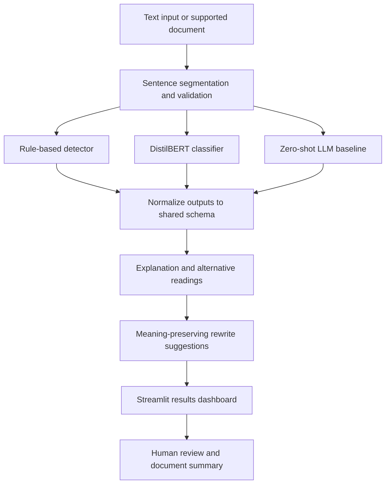
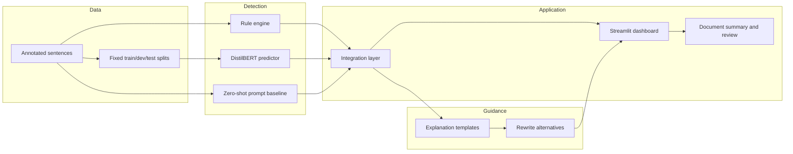

<div align="center">

# 🔎 Clarity Lint
### An NLP-powered clarity checker for requirements, contracts, and policy text

**Detect possible ambiguity. Understand alternative interpretations. Write more clearly.**

<p>
  
  
  
  
  
  
</p>

<p>
  <a href="#-overview">Overview</a> •
  <a href="#-try-the-example">Try the example</a> •
  <a href="#-how-it-works">How it works</a> •
  <a href="#-quick-start">Quick start</a> •
  <a href="#-team-roles">Team roles</a> •
  <a href="#-evaluation">Evaluation</a>
</p>

</div>

---

> [!IMPORTANT]
> **Clarity Lint is a writing-support and research project, not a legal decision-maker.** A flagged sentence may be perfectly understandable in its context, and a detector can miss real ambiguity. The tool highlights *possible* ambiguity and supports human review; it does not establish legal correctness or intent.

## 📚 Table of contents

<details open>
<summary><strong>Expand / collapse navigation</strong></summary>

- [Overview](#-overview)
- [Problem statement](#-problem-statement)
- [Project objectives](#-project-objectives)
- [Try the example](#-try-the-example)
- [Ambiguity categories](#-ambiguity-categories)
- [How it works](#-how-it-works)
- [Architecture](#-architecture)
- [Technology stack](#-technology-stack)
- [Repository structure](#-repository-structure)
- [Quick start](#-quick-start)
- [Usage](#-usage)
- [Shared prediction schema](#-shared-prediction-schema)
- [Evaluation](#-evaluation)
- [Team roles](#-team-roles)
- [Development workflow](#-development-workflow)
- [Testing and quality](#-testing-and-quality)
- [Limitations and responsible use](#-limitations-and-responsible-use)
- [Roadmap](#-roadmap)
- [Contributing](#-contributing)
- [Academic context](#-academic-context)
- [FAQ](#-faq)
- [Acknowledgements](#-acknowledgements)

</details>

## 🔎 Overview

**Clarity Lint** is a Natural Language Processing (NLP) project that analyzes requirements, contract-like text, and policy statements to identify sentences that may have more than one interpretation.

For a sentence that may be ambiguous, the intended system can:

1. Highlight the relevant sentence or phrase.
2. Predict a possible ambiguity category.
3. Explain what makes the wording unclear.
4. Show plausible alternative readings.
5. Suggest a clearer rewrite without silently guessing the author's intent.
6. Summarize findings across a document.

The project compares three complementary approaches:

| Approach | Purpose | Main trade-off |
|---|---|---|
| **Rule-based detector** | Uses explicit linguistic patterns and configurable terms | Interpretable, but patterns may miss context |
| **DistilBERT classifier** | Learns ambiguity labels from annotated examples | Learns dataset patterns and needs suitable labeled data |
| **Zero-shot LLM baseline** | Uses a documented prompt to classify text without project-specific fine-tuning | Flexible, but outputs can vary or violate the schema |

These approaches should be evaluated on the **same fixed test examples** before drawing conclusions about which works best.

## 🎯 Problem statement

Requirements and policy documents need precise language. Phrases such as “soon,” unclear modifier attachment, broad negation, and pronouns with multiple possible antecedents can make a sentence open to different readings.

For example:

> “The admin monitors the user with the sensor.”

Does **“with the sensor”** describe the tool the admin uses, or a sensor associated with the user?

Clarity Lint aims to surface this uncertainty and help the writer make the intended relationship explicit.

## 🚀 Project objectives

- Build a labeled dataset with consistent ambiguity annotations.
- Detect four types of potential ambiguity and identify sentences with no detected ambiguity.
- Implement an interpretable rule-based baseline.
- Fine-tune a DistilBERT sentence classifier.
- Build a zero-shot prompt baseline for comparison.
- Generate readable explanations and meaning-preserving rewrite alternatives.
- Integrate the components into a Streamlit application.
- Evaluate systems with reproducible splits, per-class metrics, confusion matrices, and error analysis.
- Document limitations and avoid unsupported claims.

## 🧪 Try the example

<details open>
<summary><strong>Example: attachment ambiguity</strong></summary>

**Input**

```text
The admin monitors the user with the sensor.
```

**Possible ambiguity span**

```text
with the sensor
```

**Possible reading A:** The admin uses a sensor to monitor the user.

**Possible reading B:** The user has a sensor associated with them.

**Rewrite if reading A is intended**

```text
The admin uses the sensor to monitor the user.
```

**Rewrite if reading B is intended**

```text
The admin monitors the user who is associated with the sensor.
```

> The alternatives illustrate possible interpretations; they are not claims about what the author intended. A real interface should ask the writer to select the intended reading when context does not resolve it.

</details>

<details>
<summary><strong>Example: vague wording</strong></summary>

**Input**

```text
The team will review the request soon.
```

**Potential issue:** “Soon” does not specify a measurable deadline.

**Clarification question:** What deadline or time range should “soon” mean?

**Rewrite template**

```text
The team will review the request by [specified date or time].
```

The placeholder must be filled by someone who knows the intended requirement; the system should not invent a deadline.

</details>

## 🧩 Ambiguity categories

The project uses a shared five-label vocabulary: `no_ambiguity`, `vague`, `attachment`, `scope`, and `pronoun`. The four ambiguity categories are:

<details>
<summary><strong>1. Vague terms — <code>vague</code></strong></summary>

Words or phrases do not establish a sufficiently specific or measurable condition.

**Common clues:** “soon,” “appropriate,” “regularly,” “as needed.”

**Example:** “The system should respond quickly.”

**Question to ask:** What response time qualifies as “quickly”?

</details>

<details>
<summary><strong>2. Attachment ambiguity — <code>attachment</code></strong></summary>

A phrase can grammatically relate to different words or actions, changing the interpretation.

**Example:** “The admin monitors the user with the sensor.”

**Question to ask:** Who or what is the phrase “with the sensor” describing?

</details>

<details>
<summary><strong>3. Scope ambiguity — <code>scope</code></strong></summary>

A modifier, negation, or coordinated phrase can apply to different parts of a sentence.

**Example:** “The system does not allow all users to export reports.”

Depending on the intended scope, this could mean that no users can export reports or that not all users can do so.

**Question to ask:** Which users and actions does the negation apply to?

</details>

<details>
<summary><strong>4. Pronoun/reference ambiguity — <code>pronoun</code></strong></summary>

A pronoun may refer to more than one entity.

**Example:** “Riya told Maya that she should update the report.”

**Question to ask:** Who should update the report—Riya or Maya?

</details>

<details>
<summary><strong>5. No detected ambiguity — <code>no_ambiguity</code></strong></summary>

The sentence does not exhibit one of the targeted ambiguity types under the project's annotation guidelines.

This label does **not** prove that a sentence is perfect or unambiguous in every context. It only represents the annotation decision for the task.

</details>

## ⚙️ How it works



<details>
<summary><strong>Pipeline details</strong></summary>

1. **Prepare data:** collect permitted sentences, annotate them, check label consistency, and create fixed train/dev/test splits.
2. **Detect with rules:** use conservative linguistic patterns and return evidence spans and reasons.
3. **Classify with DistilBERT:** tokenize sentences and fine-tune using training data; use development data for model selection.
4. **Run the prompt baseline:** provide label definitions, examples, and a strict output format to a zero-shot language model.
5. **Explain and rewrite:** describe plausible interpretations and offer alternatives without inventing missing intent.
6. **Integrate:** normalize each module's output and show results in a dashboard.
7. **Evaluate:** compare all approaches against the same held-out test labels and inspect errors.

</details>

## 🏗️ Architecture

The repository is organized into independent modules so team members can build and test their work without coupling core logic to the UI.



### Shared engineering principles

- Keep a single label vocabulary and schema across all modules.
- Preserve the exact source span whenever one is available.
- Keep rule, model, and prompt-baseline predictions identifiable by source.
- Use `null` for confidence when a defensible confidence value is unavailable.
- Freeze split IDs and keep test data out of training and tuning.
- Keep module logic separate from the Streamlit interface.
- Treat rewrites as suggestions requiring human review.

## 🧰 Technology stack

The intended stack includes the following tools. The exact versions should be pinned in the repository once the environment is tested.

| Technology | Role |
|---|---|
| Python | Core implementation |
| pandas | Dataset loading, cleaning, and analysis |
| scikit-learn | Data splitting and evaluation metrics |
| spaCy / regular expressions | Linguistic patterns for rule-based detection |
| Hugging Face Transformers | DistilBERT tokenizer and classifier |
| PyTorch | Model training and inference backend |
| Streamlit | Interactive web interface |
| pytest | Unit and integration testing |
| Git and GitHub | Version control and team collaboration |

## 📁 Repository structure

The following is the **proposed** structure. Update it to match the files actually committed to your repository.

```text
clarity-lint/
├── app/
│   └── app.py                         # Streamlit application
├── data/
│   ├── raw/                           # Permitted source data; often gitignored
│   ├── processed/
│   │   └── annotated_sentences.csv
│   └── splits/
│       ├── train.csv
│       ├── dev.csv
│       └── test.csv
├── src/
│   ├── preprocessing/
│   │   └── preprocess.py
│   ├── rules/
│   │   ├── vague_detector.py
│   │   ├── attachment.py
│   │   ├── scope.py
│   │   ├── pronoun.py
│   │   └── detect.py
│   ├── model/
│   │   ├── train_classifier.py
│   │   └── predict.py
│   ├── explanations/
│   │   ├── explain.py
│   │   ├── rewrite.py
│   │   ├── templates.py
│   │   └── baseline.py
│   └── integration/
│       └── merge.py
├── evaluation/
│   ├── evaluate.py
│   └── error_analysis.csv
├── tests/
├── docs/
│   ├── annotation_guidelines.md
│   ├── model_card_notes.md
│   ├── rewrite_policy.md
│   └── demo_script.md
├── outputs/                           # Generated predictions/metrics
├── requirements.txt
├── .gitignore
├── LICENSE
└── README.md
```

> [!NOTE]
> Do not commit private, confidential, or copyrighted source documents unless you have permission. Keep large model checkpoints and generated artifacts out of Git when appropriate; document how to obtain or generate them.

## 💻 Quick start

### Prerequisites

- Python 3.10 or a compatible version selected by the team.
- Git.
- A supported operating system.
- Internet access for initial dependency/model downloads where needed.
- A compatible machine for model training; a GPU may help but should not be assumed available.

### 1. Clone the repository

Replace the placeholder with your GitHub repository URL:

```bash
git clone <YOUR_GITHUB_REPOSITORY_URL>
cd clarity-lint
```

### 2. Create and activate a virtual environment

**Windows (PowerShell)**

```powershell
python -m venv .venv
.venv\Scripts\Activate.ps1
```

**macOS / Linux**

```bash
python3 -m venv .venv
source .venv/bin/activate
```

### 3. Install dependencies

Once `requirements.txt` has been created and verified:

```bash
python -m pip install --upgrade pip
pip install -r requirements.txt
```

A possible initial dependency list is shown below. Confirm compatible versions and add only dependencies the code actually uses.

```text
pandas
scikit-learn
transformers
datasets
torch
spacy
streamlit
pytest
```

If your rule detector uses spaCy's English pipeline, install the matching model as a separate setup step, for example:

```bash
python -m spacy download en_core_web_sm
```

### 4. Launch the application

After `app/app.py` and its imports are implemented:

```bash
streamlit run app/app.py
```

Streamlit will print a local address in the terminal. Open that address in your browser.

> [!WARNING]
> These are setup instructions for the proposed project structure. The application, dependency file, data, and trained checkpoint must exist before the corresponding commands will work. Do not describe the app as fully functional until an end-to-end run has been verified.

## 🖱️ Usage

The intended user flow is:

1. Open the Streamlit app.
2. Paste text into the input area, or upload a supported file if file upload has been implemented and tested.
3. Run the analysis.
4. Review each flagged sentence, category, evidence span, explanation, and possible readings.
5. Choose the intended interpretation before using a suggested rewrite when the original intent is unclear.
6. Review the document summary and any disagreement between detection methods.
7. Treat all outputs as suggestions, not authoritative legal or compliance conclusions.

### Example of a normalized result

```json
{
  "sentence_id": "S001",
  "text": "The admin monitors the user with the sensor.",
  "gold_label": "attachment",
  "predictions": [
    {
      "source": "rules",
      "label": "attachment",
      "span": "with the sensor",
      "confidence": null,
      "reason": "The prepositional phrase may attach in more than one way."
    }
  ],
  "readings": [
    "The admin uses a sensor to monitor the user.",
    "The user has a sensor associated with them."
  ],
  "rewrites": [
    "The admin uses the sensor to monitor the user."
  ]
}
```

This is an illustrative example of the proposed interface, not a claim that a working detector has already produced this output.

## 🔌 Shared prediction schema

The team should agree on a schema before independent modules are implemented. Suggested conventions:

| Field | Meaning |
|---|---|
| `sentence_id` | Stable ID for the sentence |
| `text` | Original sentence text |
| `gold_label` | Human annotation, when available |
| `predictions` | Predictions from one or more methods |
| `source` | Method identifier, such as `rules`, `model`, or `prompt` |
| `label` | One of the agreed labels |
| `span` | Exact substring from the original sentence, when available |
| `confidence` | A supported confidence value, or `null` |
| `reason` | Brief explanation for the detection |
| `readings` | Plausible alternative interpretations |
| `rewrites` | Suggested clearer alternatives |

**Allowed labels**

```text
no_ambiguity
vague
attachment
scope
pronoun
```

Do not use a new label spelling in an individual module without agreement from the team. If a model does not produce a field, the integration layer should handle the missing value explicitly rather than silently inventing one.

## 📊 Evaluation

Evaluation should measure what the system actually does, not what the team hopes it will do.

### Classification metrics

- **Precision:** Of examples predicted as a class, how many truly belong to that class?
- **Recall:** Of examples that truly belong to a class, how many did the system find?
- **F1-score:** Harmonic mean of precision and recall.
- **Macro-F1:** Average F1 across classes, giving each class equal weight.
- **Confusion matrix:** Shows which labels are confused with one another.
- **Latency:** Measured inference time under a documented environment and method.

### Fair comparison protocol

1. Create and freeze train/dev/test split IDs.
2. Fit the classifier on training data.
3. Use development data for model selection and threshold choices.
4. Keep the test set untouched until the final evaluation.
5. Run rules, DistilBERT, and the prompt baseline on the same held-out examples where each method supports the task.
6. Report per-class precision, recall, F1, macro-F1, and confusion matrices.
7. Inspect representative false positives and false negatives.
8. Record model settings, data limitations, and the environment used for latency measurements.

### Document-level summary

A potential project-defined statistic is:

```text
ambiguity_rate = flagged_sentences / total_sentences
```

Document the exact definition of “flagged,” handling of repeated or overlapping detections, and behavior for an empty document. This is a project-specific summary statistic—not a validated legal-risk score.

> [!CAUTION]
> Do not publish accuracy numbers, benchmark wins, latency claims, or dataset sizes until they have been measured and documented. A small or synthetic dataset may not represent real-world requirements or legal documents.

## 👥 Team roles

Clarity Lint is designed for a five-person team with clear module ownership.

<details>
<summary><strong>Person 1 — Dataset, annotation, and preprocessing</strong></summary>

**Owns:** Data collection, annotation guidelines, text cleaning, quality checks, and fixed splits.

**Main deliverables**
- `data/processed/annotated_sentences.csv`
- `data/splits/train.csv`, `dev.csv`, and `test.csv`
- `src/preprocessing/preprocess.py`
- `docs/annotation_guidelines.md`

**Key responsibilities**
- Define examples and edge cases for all labels.
- Coordinate annotation and inspect disagreements.
- Check duplicates, missing labels, empty text, and class balance.
- Preserve punctuation, pronouns, negation, and modifiers.
- Document sources, limitations, and split seed.

**Definition of done:** Every row has a unique ID, non-empty sentence, valid label, and reproducible split assignment.

</details>

<details>
<summary><strong>Person 2 — Rule-based ambiguity detection</strong></summary>

**Owns:** Interpretable linguistic rules and structured detections.

**Main deliverables**
- `src/rules/vague_detector.py`
- `src/rules/attachment.py`
- `src/rules/scope.py`
- `src/rules/pronoun.py`
- `src/rules/detect.py`
- Rule unit tests

**Key responsibilities**
- Build conservative, explainable patterns.
- Return the label, evidence span, reason, and source.
- Avoid treating a keyword match as proof of ambiguity.
- Test positive examples, clear negatives, and edge cases.

**Definition of done:** Deterministic, schema-compatible outputs and at least 20 hand-checked unit-test examples.

</details>

<details>
<summary><strong>Person 3 — DistilBERT classifier</strong></summary>

**Owns:** Model training, inference, and model-vs-rules comparison support.

**Main deliverables**
- `src/model/train_classifier.py`
- `src/model/predict.py`
- Saved model/tokenizer or documented checkpoint location
- `outputs/model_test_predictions.csv`
- `outputs/model_metrics.json`
- `docs/model_card_notes.md`

**Key responsibilities**
- Use the agreed label mapping and fixed data splits.
- Fine-tune DistilBERT and select settings using train/dev only.
- Save a reproducible checkpoint and inference function.
- Report per-class metrics, macro-F1, confusion matrix, and errors.

**Definition of done:** The checkpoint reloads, predicts unseen sentences, and has documented test results and limitations.

</details>

<details>
<summary><strong>Person 4 — Explanations, rewrites, and prompt baseline</strong></summary>

**Owns:** Human-readable explanations, alternative readings, controlled rewrites, and zero-shot baseline.

**Main deliverables**
- `src/explanations/explain.py`
- `src/explanations/rewrite.py`
- `src/explanations/templates.py`
- `src/explanations/baseline.py`
- `docs/rewrite_policy.md`

**Key responsibilities**
- Use the shared label definitions and evidence spans.
- Present plausible readings without claiming they are facts.
- Offer alternatives when intended meaning is unknown.
- Avoid adding obligations, deadlines, actors, or conditions.
- Document prompt, settings, schema validation, and failures.

**Definition of done:** Tested explanation templates, plausible alternatives, safe handling of invalid baseline output, and documented rewrite policy.

</details>

<details>
<summary><strong>Person 5 — Integration, dashboard, and evaluation</strong></summary>

**Owns:** Streamlit app, adapters, end-to-end integration, evaluation, and demo.

**Main deliverables**
- `app/app.py`
- `src/integration/merge.py`
- `evaluation/evaluate.py`
- Error-analysis report
- `requirements.txt`, `README.md`, and `docs/demo_script.md`

**Key responsibilities**
- Create the repository skeleton and a mock-data UI early.
- Stabilize the shared schema with all team members.
- Integrate each module one at a time.
- Show source/method labels and disagreements.
- Compare methods on the same held-out examples.
- Measure latency and prepare a reproducible demo.

**Definition of done:** A new user can follow the setup guide, launch the app, run the integrated pipeline, and review documented evaluation results.

</details>

## 🌿 Development workflow

A practical sequence for a five-person student team:

| Phase | Work |
|---|---|
| Day 1 | Agree on labels, schema, annotation guidelines, repository structure, and mock UI |
| Days 2–4 | Annotate data; build rule modules and UI in parallel |
| Days 4–7 | Train initial classifier; complete explanation templates and prompt baseline |
| Integration | Connect rules, model, explanations, and prompt baseline one at a time |
| Final phase | Freeze code and splits, run final evaluation, analyze errors, rehearse the demo |

The timeline is a suggested plan, not a guarantee. Adjust it to the team's actual schedule and project scope.

### Git collaboration

```bash
# Start from the latest shared branch
git checkout main
git pull

# Create a focused branch
git checkout -b feature/rule-detector

# Stage and commit a small, testable change
git add src/rules tests
git commit -m "Add conservative vague-term detector"

# Push the branch
git push -u origin feature/rule-detector
```

Recommended team practices:

- One focused branch or clearly owned module per task.
- Small commits with descriptive messages.
- Pull requests for review and integration.
- Tests run before merging.
- Communicate schema or dataset changes before other members depend on them.
- Keep secrets, private data, virtual environments, and large generated files out of commits.

## 🧪 Testing and quality

Run tests from the repository root after creating the test suite:

```bash
pytest -q
```

Useful test categories:

- **Unit tests:** each rule and transformation in isolation.
- **Schema tests:** outputs use valid labels and required keys.
- **Regression tests:** every fixed bug has a test.
- **Integration tests:** rules, model, explanations, and UI adapters work together.
- **Data validation:** duplicate leakage, missing values, invalid labels, and empty text.
- **Rewrite review:** meaning preservation, no invented requirements, and explicit alternatives when intent is unknown.
- **End-to-end smoke test:** run the app on a small, permitted example dataset.

## ⚖️ Limitations and responsible use

- **Possible ambiguity, not certainty:** a flagged phrase is a signal for review, not proof of an error.
- **Context matters:** a sentence may be clear in a larger document or domain context.
- **Dataset limitations:** synthetic or small datasets can limit generalization.
- **Model limitations:** DistilBERT learns patterns from the labels and examples provided; it does not guarantee understanding of legal meaning.
- **Rule limitations:** linguistic rules may generate false positives and false negatives.
- **LLM limitations:** generated outputs can be inconsistent, malformed, or meaning-changing.
- **Rewrite safety:** if the author's intent is unknown, ask for clarification or show alternatives.
- **Privacy:** do not upload confidential documents to external services without authorization.
- **No legal advice:** users must review suggestions and seek qualified review for consequential legal or compliance decisions.

## 🗺️ Roadmap

The following items are possible milestones. Mark them complete only when verified in the repository.

- [ ] Finalize annotation guidelines and shared JSON schema.
- [ ] Create and validate the labeled dataset.
- [ ] Freeze reproducible train/dev/test split IDs.
- [ ] Implement and test the four rule detectors.
- [ ] Train and save the DistilBERT classifier.
- [ ] Build the zero-shot prompt baseline.
- [ ] Add explanation templates and rewrite alternatives.
- [ ] Integrate all methods in Streamlit.
- [ ] Add evaluation tables and confusion matrices.
- [ ] Complete error analysis and model-card notes.
- [ ] Verify installation and launch steps on a clean environment.
- [ ] Prepare demo, report, and viva explanation.

## 🤝 Contributing

Contributions from teammates are welcome when they preserve the shared interface and are backed by tests.

1. Check the relevant module owner before changing shared behavior.
2. Open an issue or discuss substantial schema changes.
3. Create a focused branch.
4. Add or update tests.
5. Document setup or behavior changes.
6. Open a pull request and explain what was tested.

### Before opening a pull request

- [ ] The change has a clear purpose.
- [ ] Shared label names and JSON keys remain consistent.
- [ ] Existing tests pass; new behavior has tests.
- [ ] No private data, credentials, or unsupported performance claims are included.
- [ ] Documentation reflects actual behavior.

## 🎓 Academic context

This project combines concepts from:

- Natural Language Processing and linguistic ambiguity.
- Supervised text classification.
- Transformer fine-tuning with DistilBERT.
- Rule-based systems and interpretable baselines.
- Prompt engineering and structured LLM outputs.
- Software engineering, testing, and modular design.
- Experimental evaluation, error analysis, and reproducibility.

### Suggested viva explanation

> Clarity Lint is a hybrid NLP system for identifying possible ambiguity in requirements and contract-like text. It compares interpretable linguistic rules, a DistilBERT classifier, and a zero-shot prompt baseline. For flagged sentences, it explains possible interpretations and suggests clearer alternatives. We evaluate the approaches on a fixed held-out test set and inspect errors because the system is a writing aid, not a legal decision-maker.

## ❓ FAQ

<details>
<summary><strong>Does a flagged sentence definitely contain an error?</strong></summary>

No. The system identifies possible ambiguity. A human should review the evidence and context.

</details>

<details>
<summary><strong>Why use both rules and DistilBERT?</strong></summary>

Rules provide interpretable evidence and a baseline. DistilBERT learns patterns from annotated examples. Comparing them helps reveal different strengths and failure modes.

</details>

<details>
<summary><strong>Why include a zero-shot prompt baseline?</strong></summary>

It provides a comparison with a general language-model approach without project-specific classifier fine-tuning. Its prompt, settings, output validity, and limitations should be documented.

</details>

<details>
<summary><strong>Can the tool automatically decide the intended meaning?</strong></summary>

Not reliably. When intent is unclear, the system should offer alternatives or ask the writer to clarify rather than guess.

</details>

<details>
<summary><strong>Is the document ambiguity rate a legal-risk score?</strong></summary>

No. It is a project-defined summary statistic. It must not be represented as a validated legal-risk or compliance score.

</details>

<details>
<summary><strong>Where do I report a bug?</strong></summary>

Open an issue in the project's GitHub repository with reproduction steps, expected behavior, actual behavior, and a minimal non-sensitive example.

</details>

## 🙌 Acknowledgements

Built as a collaborative academic project exploring practical NLP, ambiguity detection, and human-centered writing support.

**Team Members:**  
- Shaik Irfan
- Karanam Chaitanya 
- Rajeev Kumar
- Sudharshan Karmakar
- Aman Kumar

**License:** Refer to the project license specification.

---

<div align="center">

**Clarity Lint — make the intended meaning clearer.**

<sub>Remember: documented goals are not measured results. Update this README as implementation and evaluation progress.</sub>

</div>
